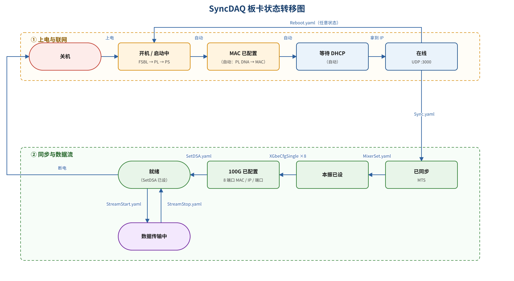

# SyncDAQ 板卡操作手册

T510 ｜ Zynq UltraScale+ RFSoC（xczu47dr）｜ 8 路 I/Q ｜ 100G CMAC ｜ 2026-10-20

> 与 `system_notes.typ`（调试/验证笔记）分工：这份是给使用者的操作手册。

## 1 系统概览

SyncDAQ 是一块**同步采集板**：8 路 I/Q ADC 经 RFDC 下变频，FPGA 侧打包成 Eth/IPv4/UDP，从 **100G CMAC（QSFP 4×25G）** 上行给主机；主机通过 **UDP :3000** 发指令控制它。

| 项 | 值 |
|---|---|
| 板卡 | MicroPhase ANTSDR T510（xczu47dr） |
| 采样 | 8 路 I/Q，每路 320 MS/s（100/640 MSps 为其它固件变体） |
| 控制面 | 千兆 SFP，板卡 DHCP 到 `192.168.5.174`，UDP :3000 |
| 数据面 | 100G CMAC，每通道 8192 B 负载 + 32 B MetaData，上行到主机 `4000–4007` |
| 时钟 / 同步 | LMK04828；GPS 或外部 10 MHz + 1 PPS，多板靠同一 PPS 对齐 |

### 1.1 软件

| 仓库 | 语言 | 作用 |
|---|---|---|
| `~/src/syncdaq` | Rust | 控制协议（`CtrlMsg`）、收发指令、100G 收数与下抽样、C FFI |
| `~/src/soapy_syncdaq` | C++ | 把 `syncdaq` 包成 SoapySDR 驱动（GNU Radio / SDR 软件用） |

构建：`cd ~/src/syncdaq && cargo build --release`。下文命令都假定当前目录是 `~/src/syncdaq`。

## 2 网络规划

| 面 | 主机 | 板卡 | 说明 |
|---|---|---|---|
| 控制面 | `eth0 192.168.5.1/24` | DHCP：`192.168.5.100–150` | 发指令、查状态；UDP :3000 |
| 数据面 | `eno1np0 10.100.11.1/24`（mtu 9000） | `10.100.11.20–27:3001` | 8 路上行 → 主机 `4000–4007` |

- 通道号 = `port_id` = 目的端口 − 4000。
- DHCP 服务可以是一台常驻服务器，也可以用 `./dhcp.sh` 临时起 `udhcpd`（池 `.100–.150`）。
- 板卡地址不固定，**用广播探活**：

```bash
./target/release/bcast_cmd -a 192.168.5.255:3000 -c cmd/Query.yaml -d 1 -t 3
```

收到 **336 B** 回包即在线。

## 3 状态转移

从开机到出数据是一条单向链：**上电 → 自动联网 →（主机指令）同步 / 本振 / 100G 装订 / DSA → 开始传输**。`StreamStop` 只回到「就绪」，不回到「离线」。



### 3.1 状态

| 状态 | 进入方式 | 含义 |
|---|---|---|
| 关机 | 断电 | 板卡不在线 |
| 开机 / 启动中 | 上电 | FSBL → PL → PS，LMK/CMAC/RFDC 初始化 |
| MAC 已配置 | 自动 | 控制口 MAC 由 PL DNA 派生（失败用 fallback） |
| 等待 DHCP | 自动 | 无地址时 UDP 服务不建 socket |
| 在线 | 拿到 IP | UDP :3000 可收指令、可 `Query`（336 B 回包） |
| 已同步 | `Sync.yaml` | RFDC MTS 完成（前置 `SetClk` 选时钟/PPS 源） |
| 本振已设 | `SetMixer.yaml` | 各通道 LO 频率/相位 |
| 100G 已配置 | `XGbeCfgSingle` ×8 | 8 个端口的源/目的 MAC、IP、UDP 端口 |
| 就绪 | `SetDSA.yaml` | 可开流；上电后必须显式 `SetDSA`（默认大衰减，`GetDSA` 假回读 0） |
| 数据传输中 | `StreamStart.yaml` | PL `transmitting=1`，8 路 UDP 上行 |

### 3.2 转移

| from | to | 触发 | 说明 |
|---|---|---|---|
| 关机 | 开机 | 上电 | 启动链开始 |
| 开机 | MAC 已配置 | 自动 | `port_mac()` |
| MAC 已配置 | 等待 DHCP | 自动 | `dhcp_start()` |
| 等待 DHCP | 在线 | 拿到 IP | 地址非 0 → UDP 服务建 socket |
| 在线 | 已同步 | `Sync.yaml` | MTS；内部先 `stop_stream()` |
| 已同步 | 本振已设 | `SetMixer.yaml` | `sync=1` 时等 PPS 边沿 |
| 本振已设 | 100G 已配置 | `XGbeCfgSingle` ×8 | 逐口装订 |
| 100G 已配置 | 就绪 | `SetDSA.yaml` | 上电后必须做 |
| 就绪 | 数据传输中 | `StreamStart.yaml` | PPS 对齐，0~1 s 生效；帧计数清零 |
| 数据传输中 | 就绪 | `StreamStop.yaml` | PPS 对齐，等 `transmitting=0` |
| 任意在线状态 | 开机 | `Reboot.yaml` | 软 POR / 看门狗；任意在线状态均可发 |
| 就绪 | 关机 | 断电 | 直接断电 |

> **三个时序坑**
> ① `StreamStart` / `StreamStop` 只在**下一个 PPS 上升沿**生效（0~1 s 延迟），两次之间至少间隔 1 s；
> ② `Sync` / `SetClk` 内部先 `stop_stream()`，传输中发会强制停流；
> ③ `StreamStop` 之后至少**等 2 s** 再数包，否则数到的是"还没生效期间"的包。

## 4 指令参考

指令是 YAML 文件（`cmd/*.yaml`），用 `send_cmd` 发送。推荐用 `./send_cmd.sh`（会自动对齐到整数秒 + 0.5 s）：

```bash
./send_cmd.sh -a 192.168.5.174:3000 -c cmd/<指令>.yaml -d 1 -t 3
```

| 指令 | YAML | 作用 | 前置状态 |
|---|---|---|---|
| `Query` | `cmd/Query.yaml` | 查状态（336 B 回包：温度、`locked`、`smp_rate`、8 通道计数…） | 在线 |
| `XGbeCfgQuery` | `cmd/XGbeCfgQuery.yaml` | 读 8 个 100G 端口的装订结果 | 在线 |
| `SetClk` | `cmd/gps.yaml` / `cmd/ext_clk.yaml` | 时钟 / PPS 源（`clk_src`：1=GPS，2=外部 10 MHz） | 在线 |
| `GetClk` | `cmd/GetClk.yaml` | 读回时钟配置（20 B 回包：`clk_src` / `pps_src` / `clk_state`）。读的是 PS GPIO pin33/34 电平与 `PPS_SEL` 寄存器的**实际值**，不缓存；上电后从未 `SetClk` 也能读 | 在线 |
| `Sync` | `cmd/Sync.yaml` | RFDC MTS 同步，开机做一次 | 停流 |
| `SetMixer` | `cmd/SetMixer.yaml` | 设本振（`sync=1` 等 PPS 边沿） | 在线 |
| `GetMixer` | `cmd/GetMixer.yaml` | 读回 RFDC 内部当前本振（`NPORTS` 个通道的 freq/phase）。固件每次都用 `XRFdc_GetMixerSettings()` 现读，**不缓存**，所以 MTS 重排相位/别处改过 NCO 后反映的是硬件真实值；上电未设过时是 IP 默认 NCO（320 工程实测 `-160.000000`，即 PL 里 `ADC_NCO_Freq=0.16 GHz` 取负） | 在线 |
| `XGbeCfgSingle` | `cmd/XGbeCfgSingle.yaml` | 逐口装订 100G 源/目的 MAC、IP、端口 | 停流 |
| `SetDSA` | `cmd/SetDSA.yaml` | 设片上衰减；上电后必做 | 在线 |
| `GetDSA` | `cmd/GetDSA.yaml` | 读片上衰减（单端口，`port_id` 指定）。注意回读值不等于实际衰减，见 §6.1 的说明 | 在线 |
| `QsfpInfo` | `cmd/QsfpInfo.yaml` | 读光模块（96 B 回包：温度、VCC、四路 TX 偏置 / RX / TX 光功率、LOS/LOL、`modpresent`、CDR / 均衡设置）。`modpresent` 是 ModPrsL 电平（低有效：0=在位），主机打印成 `present` / `absent` | 在线 |
| `QsfpSet` | `cmd/QsfpSet.yaml` | 设 `ModSelL` / `LPMode` / CDR / 均衡（28 B 请求）。**不含 `restl`**：RstL 由 `QsfpReset` 独占，固件用 read-modify-write 只改另外两位 | 在线 |
| `QsfpReset` | `cmd/QsfpReset.yaml` | 复位光模块：单个动作，RstL 拉低 `hold_ms` 毫秒后拉高。`hold_ms` 必填，`0` = 最小 1 ms，超过 500 钳到 500（handler 持 `cmd_mutex`，睡多久两个网口的命令线程就堵多久） | 在线 |
| `GetGt` | `cmd/GetGt.yaml` | 读回四路 GT 的 pre-cursor / post-cursor / txdiff（20 B 回包，与 `GtSet` 请求体同构）。读的是 PL 里 `XPAR_GT_*` 三个寄存器的实际值，PL 重配 / 链路重训后读到的是复位值 | 在线 |
| `StreamStart` | `cmd/StreamStart.yaml` | 开始数据传输（PPS 对齐） | 就绪 |
| `StreamStop` | `cmd/StreamStop.yaml` | 停止数据传输（PPS 对齐） | 传输中 |
| `QueryBitShift` | `cmd/QueryBitShift.yaml` | 查 8bit 固件每通道取哪 8 位 | 在线 |
| `Reboot` | `cmd/Reboot.yaml` | 重启（`mode`：0 软 POR，1 停喂狗，2 恢复喂狗） | 任意在线状态 |
| `FetchFW` / `SwitchFW` | `cmd/FetchFW.yaml` | 网络升级固件；切换后需重启生效 | 在线 |

## 5 指令超时时间

`send_cmd` 的 `-t` 是**等回包的秒数**（默认 1 s）。实测方法：直接发 UDP，记从发出到收到回包的时间，每条指令 3 次（板卡 `192.168.5.164`，320 MSps 固件）。

| 指令 | 实测耗时 | 建议 `-t` | 说明 |
|---|---|---|---|
| `Query` | 10 ms | 1 | |
| `XGbeCfgQuery` | 26 ms | 1 | |
| `GetDSA` | 3–7 ms | 1 | |
| `SetDSA` | 3 ms | 1 | |
| `QueryBitShift` | 0.3 ms | 1 | |
| `QsfpInfo` | 407 ms | 1 | I²C 读光模块，普通指令里最慢 |
| `QsfpSet` | 未单独测 | 1 | 写 I²C，与 `QsfpInfo` 同量级 |
| `QsfpReset` | `hold_ms` + 往返 | 1 | 实测 `hold_ms`=0/10/600 时 0.00 / 0.01 / 0.49 s（600 被钳到 500） |
| `GetClk` / `GetGt` | < 10 ms | 1 | 纯寄存器读，与 `Query` 同量级 |
| `StreamStart` | 11 ms | 1 | 回包快；真正生效要等下一个 PPS |
| `StreamStop` | 11 ms | 1 | 同上 |
| `SetClk` | 31 ms | 1 | |
| `XGbeCfgSingle` | 未单独测 | 1 | 与 `SetDSA` 同量级 |
| `SetMixer`（`sync=1`） | 1.4 s | 2 | 等下一个 PPS 边沿 |
| `GetMixer` | 8 ms | 1 | 8 次 `XRFdc_GetMixerSettings()` + 回包（实测 320 固件） |
| `Sync` | 1.4 s | 2 | MTS 同样卡在 PPS 上 |
| `Reboot` | 回包 < 100 ms | 3 | 见下 |
| `FetchFW` / `SwitchFW` | 异步 / 数十秒 | 40 | `SwitchFW` 同步等 md5 检查 |

> **口径**：普通指令 `-t 1` 足够（最慢的 `QsfpInfo` 才 0.4 s；`QsfpReset` 最长 0.5 s，也在 1 s 内）；只有 **`SetMixer`（`sync=1`）和 `Sync` 实测约 1.4 s**，给 `-t 2` 留余量。

> **`Reboot` 的坑**：`Reboot` 的回包本身很快，但板卡收到后会立即复位，所以 `-t` 给 **3** 就够（等的是回包，不是启动）。两个前提：
> ① 板卡必须是 **SD / eMMC 启动**——JTAG 启动模式下软 POR 不生效，发 `Reboot` 后板卡直接失联，只能重新烧录或断电恢复；
> ② 回包不代表重启完成，板卡重新上线还要几十秒（未实测，待补）。

## 6 标准操作流程

### 6.1 开机与初始化

```bash
cd ~/src/syncdaq
./send_cmd.sh -a 192.168.5.174:3000 -c init_rfsoc.yaml -d 1 -t 10   # SetClk + Sync + 8×XGbeCfgSingle + SetMixer
./send_cmd.sh -a 192.168.5.174:3000 -c cmd/SetDSA.yaml -d 1 -t 3     # 上电必做
```

`init_rfsoc.yaml` 一条命令完成整套初始化；`Sync` 开机一次就够，不要每轮都发。上电后如果不设 `SetDSA`，片上衰减器会停在默认大衰减态，而 `GetDSA` 仍回读 0。

### 6.2 采集

```text
1. StreamStop（确保在停止状态）
2. 等 ≥1 s，确认收包数 ≈ 0
3. 先准备好接收 socket（bind 到 4000+port_id，进入等待）
4. 再 StreamStart（send_cmd.sh，PPS 对齐）
5. 立即收包 → 抓到的首包 pkt_cnt 应为 0
```

> **必须**：接收程序要在 `StreamStart` **之前**就绪，否则抓不到第 0 帧，会抓到流中间的包（对比无效）。

### 6.3 停止

```bash
./send_cmd.sh -a 192.168.5.174:3000 -c cmd/StreamStop.yaml -d 1 -t 2
sleep 2   # 等 PPS 生效，再数包
```

### 6.4 关机

直接断电。重新上电后从「开机 / 启动中」重新走一遍。

## 7 故障排除

| 现象 | 常见原因 | 处理 |
|---|---|---|
| 拿不到 DHCP 地址 | DHCP 服务没起 / 绑错网口 / 防火墙 67、68 未放行 / 用了 RJ-45 口 | 查 `dhcp.sh`、网口与防火墙；用 `bcast_cmd` 广播探活 |
| 指令发出、板卡收到但主机没回包 | 控制口与其他网口同网段，触发反向过滤 | `rp_filter=0`（见下） |
| `StreamStop` 不生效 | 用了裸 `send_cmd`，PPS 对齐不可靠 | 改用 `./send_cmd.sh` |
| 收不到数据 | 100G 口未配 / `XGbeCfg` 未装订 / mtu 不是 9000 / 防火墙 | 逐项检查；`XGbeCfgQuery` 回读 |
| 数据路径冻结 | 快速反复 Stop/Start | 重新 `init_rfsoc` → `Sync` |
| 上电后幅度很小 | `SetDSA` 没做（默认大衰减，回读仍是 0） | 上电后显式 `SetDSA.yaml` |

```bash
# 反向过滤（能发不能收时）
sudo sysctl -w net.ipv4.conf.all.rp_filter=0
sudo sysctl -w net.ipv4.conf.default.rp_filter=0
```

## 8 附录：关键路径

| 项 | 路径 |
|---|---|
| 主机软件 | `~/src/syncdaq` |
| 指令模板 | `~/src/syncdaq/cmd/*.yaml` |
| 全量初始化 | `~/src/syncdaq/init_rfsoc.yaml` |
| 半秒对齐发送器 | `~/src/syncdaq/send_cmd.sh` / `aligned_send.sh` |
| 固件工程 | `~/fpga/sync_daq_{100,320,640}MSps_iq` |
| 固件 PS 源码 | `~/fpga/sync_daq_320MSps_iq/sw/daq_sys/src` |
| 状态转移图源 | `~/src/syncdaq/doc/syncdaq_state.svg` / `~/fpga/doc/gen_state_svg.py` |
| 调试笔记（更细） | `~/src/syncdaq/doc/system_notes.typ` |
